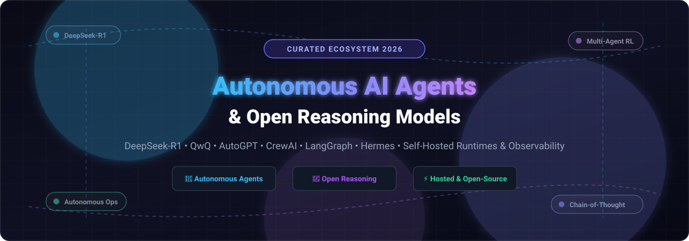

# 🤖 Awesome Autonomous AI Agents & Open Reasoning Models 🧠

**The premier curated directory of production-grade Autonomous AI Agents, Open-Weight Reasoning Models (Reinforcement Learning / Test-Time Chain-of-Thought), Multi-Agent Orchestration Frameworks, and Self-Hosted Agent Observability Runtimes.**

*Tracked, analyzed, and updated for researchers, ML engineers, software developers, and enterprise automation architects.*

📅 **Last updated: November 2026**

---

## 📌 Table of Contents

- [🌐 Sector Overview & Market Dynamics](#-sector-overview--market-dynamics)
- [🏢 SaaS & Hosted Platforms](#-saas--hosted-platforms)
- [💻 Open-Source GitHub Projects](#-open-source-github-projects)
- [📈 Star History](#-star-history)
- [🤝 How to Contribute](#-how-to-contribute)
- [💖 Support & Sponsorship](#-support--sponsorship)
- [⚠️ Disclaimer](#️-disclaimer)

---

## 🌐 Sector Overview & Market Dynamics

The global **Autonomous AI Agents (Agentic AI)** market is estimated at **$9.9B – $11.5B in 2026** and projected to surge past **$110B+ by the early 2030s** at an aggressive **~43–47% CAGR**. Market dynamics exhibit a bifurcated structure: **highly fragmented** across thousands of niche application and workflow startups, yet **moderately concentrated** at the infrastructure, runtime, and foundational reasoning layer where top venture-backed unicorns and cloud hyperscalers capture the bulk of enterprise compute and deployment spend.

---

## 🏢 SaaS & Hosted Platforms

| Platform | Valuation / Size | Starting Pricing | Free Tier Limits | Description |
| :--- | :--- | :--- | :--- | :--- |
| **[Devin (Cognition AI)](https://cognition.ai)** | $48B valuation (Series E; ~$900M run-rate revenue) | $20/month (Pro plan) | Light usage quota to code with agents; unlimited inline edits & Tab completions (Devin Desktop/CLI) | Autonomous AI software engineering platform with an isolated cloud terminal, code editor, browser, and long-horizon reasoning engine. |
| **[Adept AI](https://adept.ai)** | $1B valuation (Peak Series B; core IP & team licensed to Amazon for ~$25M) | Contact sales / Enterprise pilot | Enterprise-managed pilot / proof-of-concept upon sales approval (no public self-serve trial) | Enterprise multimodal AI agent platform trained to perceive graphical user interfaces and automate complex cross-application workflows. |
| **[MultiOn](https://multion.ai)** | ~$100M valuation ($20M Series A led by General Catalyst) | $20/month (Pro plan) | ~100 web actions/month via Chrome extension & web app | Cloud-hosted personal and enterprise web-browsing AI agent API capable of navigating websites, filling forms, and executing online actions. |
| **[Stack AI](https://stack-ai.com)** | $75M valuation (Acquired by Asana; ~$3M ARR) | Custom enterprise pricing / contact sales | 500 runs/month, 2 projects, and 1 user seat | Enterprise no-code/low-code AI workflow and autonomous agent builder connecting frontier reasoning models to databases, APIs, and guardrails. |
| **[Fixie.ai (Ultravox)](https://fixie.ai)** | $51.5M valuation (Seed stage; acquired by Inworld AI) | $100/month (Pro plan; pay-as-you-go at $0.05/min) | 30 minutes of free voice calls, up to 5 concurrent calls, unlimited playground calls | Cloud platform for building and hosting conversational, voice-enabled, and tool-using autonomous speech agents. |
| **[Lindy](https://lindy.ai)** | ~$50M–$54M total funding raised | $29.99/user/month (Plus plan) | 7-day free trial with $50 worth of trial credits (automated actions pause once credits exhaust) | No-code autonomous AI agent platform enabling business teams to build and schedule multi-step AI employees across email, CRM, and calendar. |
| **[Relevance AI](https://relevanceai.com)** | ~$37M total funding raised ($24M Series B; ~$3M–$12M ARR) | $29/month ($19/month billed annually for Pro plan) | No permanent free tier; 2,500 Actions/month & base vendor credits on starter paid tier (BYOK supported) | Cloud multi-agent workforce platform enabling organizations to build, chain, and deploy autonomous research, outreach, and operations agents. |
| **[CrewAI Enterprise](https://crewai.com)** | ~$18M total funding raised (Series A; ~$2.4M–$3.2M ARR) | $25/month (Professional tier) | 50 workflow executions/month, 1 user seat, access to Crew Studio and AI Copilot | Managed cloud control plane for deploying, scaling, tracing, and governing collaborative role-based multi-agent workflows in production. |
| **[AgentOps](https://agentops.ai)** | ~$2.6M total seed funding raised | $40/month (Pro pay-as-you-go) | 5,000 events/month, 7-day data retention, single user | Cloud observability, session replay, latency tracking, and cost-monitoring platform built for debugging and evaluating autonomous AI agents. |

---

## 💻 Open-Source GitHub Projects

Curated open-weight reasoning models, autonomous agent frameworks, runtimes, and developer tooling—**sorted in descending order by GitHub_Stars**:

- **[NousResearch/hermes-agent](https://github.com/NousResearch/hermes-agent)**   
  *Next-gen autonomous agent framework from Nous Research engineered for deep function calling, structured multi-step reasoning, persistent episodic memory, and open-weight Hermes reasoning models.* 🧠⚡

- **[AutoGPT (`Significant-Gravitas/AutoGPT`)](https://github.com/Significant-Gravitas/AutoGPT)**   
  *Pioneering open-source autonomous agent platform providing a visual agent builder graph, long-term memory, modular agent skills, and continuous goal-driven task execution.* 🤖✨

- **[browser-use (`browser-use/browser-use`)](https://github.com/browser-use/browser-use)**   
  *Open-source web automation library making websites accessible for autonomous AI agents via DOM perception, Playwright automation, and vision-language model execution.* 🌐🦾

- **[DeepSeek-R1 (`deepseek-ai/DeepSeek-R1`)](https://github.com/deepseek-ai/DeepSeek-R1)**   
  *Breakthrough open-weight reasoning model family trained via large-scale Reinforcement Learning (GRPO) to generate long Chain-of-Thought (CoT) problem-solving for coding, math, and logic.* 💡🧪

- **[MetaGPT (`FoundationAgents/MetaGPT`)](https://github.com/FoundationAgents/MetaGPT)**   
  *Multi-agent software engineering framework simulating an entire software company (Product Managers, Architects, Project Managers, Engineers) with Standard Operating Procedures (SOPs).* 🏢💻

- **[AutoGen & AG2 (`microsoft/autogen` / `ag2ai/ag2`)](https://github.com/microsoft/autogen)**   
  *Microsoft's multi-agent conversational framework enabling event-driven, multi-agent cooperation, automated code execution sandboxes, and human-in-the-loop oversight.* 🔄👥

- **[CrewAI (`crewAIInc/crewAI`)](https://github.com/crewAIInc/crewAI)**   
  *Leading Python framework for orchestrating collaborative teams of autonomous AI agents with customized roles, memory, goal delegation, and specialized tools.* 🤝⚙️

- **[LangGraph (`langchain-ai/langgraph`)](https://github.com/langchain-ai/langgraph)**   
  *Stateful, cyclical multi-agent graph coordination library featuring durable state persistence, time-travel debugging, and human approval checkpoints.* 🕸️🔄

- **[Langfuse (`langfuse/langfuse`)](https://github.com/langfuse/langfuse)**   
  *Open-source LLM engineering and AI agent observability platform providing full trace trees, prompt management, cost tracking, and reasoning step analytics.* 📊🔍

- **[ChatDev (`OpenBMB/ChatDev`)](https://github.com/OpenBMB/ChatDev)**   
  *Virtual software development company operated by multi-agent role-playing communicating via communicative de-biasing dialogues to design, code, and test applications.* 💬🛠️

- **[smolagents (`huggingface/smolagents`)](https://github.com/huggingface/smolagents)**   
  *Lightweight, code-first agent library from Hugging Face where agents write and run raw Python actions rather than verbose JSON blobs for maximum speed and simplicity.* ⚡🐍

- **[Open-R1 (`huggingface/open-r1`)](https://github.com/huggingface/open-r1)**   
  *Fully open-source initiative by Hugging Face replicating the DeepSeek-R1 pipeline from synthetic data collection, SFT reasoning traces, to GRPO reinforcement learning.* 🔓🔬

- **[verl (`verl-project/verl`)](https://github.com/verl-project/verl)**   
  *High-throughput, flexible reinforcement learning training library for LLMs and reasoning models (Volcano Engine RL) supporting Hybrid-Engine PPO and GRPO at scale.* 🚀🧠

- **[BabyAGI (`yoheinakajima/babyagi`)](https://github.com/yoheinakajima/babyagi)**   
  *Foundational autonomous task-driven agent that created the paradigm of autonomous task creation, task prioritization, and recursive execution loops.* 👶🔄

- **[OpenAI Swarm (`openai/swarm`)](https://github.com/openai/swarm)**   
  *Educational, ergonomic multi-agent orchestration framework from OpenAI exploring lightweight agent handoffs, tool routines, and multi-agent coordination.* 🐝🔀

- **[PydanticAI (`pydantic/pydantic-ai`)](https://github.com/pydantic/pydantic-ai)**   
  *Production-grade Python agent framework built by the Pydantic team, bringing strict type validation, dependency injection, and model-agnostic execution.* 🛡️🐍

- **[SWE-agent (`SWE-agent/SWE-agent`)](https://github.com/SWE-agent/SWE-agent)**   
  *Autonomous software engineering agent built by Princeton NLP that fixes bugs and resolves real GitHub issues using an Agent-Computer Interface (ACI).* 🧑‍💻🐛

- **[SuperAGI (`TransformerOptimus/SuperAGI`)](https://github.com/TransformerOptimus/SuperAGI)**   
  *Dev-first autonomous AI agent framework featuring concurrent agent execution, graphical telemetry, vector memory storage, and extensible multi-tool integration.* 🦾🔋

- **[E2B (`e2b-dev/E2B`)](https://github.com/e2b-dev/E2B)**   
  *Secure cloud sandboxes and execution environments for AI agents to run untrusted code, execute terminal commands, and browse web environments safely.* 📦🔒

- **[Arize Phoenix (`Arize-ai/phoenix`)](https://github.com/Arize-ai/phoenix)**   
  *AI observability and agent evaluation platform featuring OpenTelemetry tracing, span evaluation, embedding visualization, and hallucination monitoring.* 🔭📈

- **[OpenRLHF (`OpenRLHF/OpenRLHF`)](https://github.com/OpenRLHF/OpenRLHF)**   
  *Ray-based distributed RLHF and reasoning post-training framework supporting 70B+ model training with PPO, DPO, KTO, and GRPO.* ⚡🏋️‍♂️

- **[SkyThought / Sky-T1 (`NovaSky-AI/SkyThought`)](https://github.com/NovaSky-AI/SkyThought)**   
  *Open-source reasoning model initiative curating high-quality verifiable math/code Chain-of-Thought datasets and post-training recipes.* 🌌📚

- **[QwQ / Qwen3 (`QwenLM/QwQ`)](https://github.com/QwenLM/QwQ)**   
  *Alibaba's open-weight reasoning model family showcasing step-by-step thinking, mathematical logic, code generation, and test-time compute exploration.* 🧠📐

---

## 📈 Star History

---

## 🤝 How to Contribute

Contributions are warmly welcomed! Help make this ecosystem repository comprehensive and accurate:

1. 🍴 **Fork the repository**.
2. 🌿 **Create a descriptive branch** (`git checkout -b add-agent-platform`).
3. 📝 **Add or update entries in `README.md`** following the existing tabular or sorted list structure.
4. ✨ **Include verifiable facts**: Link directly to official sites/repos, note accurate pricing tiers, free tier limits, or GitHub star metrics.
5. 🚀 **Submit a Pull Request** with a concise description of your additions.

---

## 💖 Support & Sponsorship

If you find this curated collection useful for your research, team, or projects, please consider supporting the project:

- ⭐ **Star this repository** to help others discover it!
- 🍴 **Fork and share** with fellow developers and AI practitioners.
- ☕ **Buy a coffee or sponsor ongoing maintenance**: [Sponsor Ishan Dutta on GitHub](https://github.com/sponsors/ishandutta2007)

*Your support helps maintain daily tracking of frontier AI agents and open reasoning model breakthroughs! Thank you!* 🙏

---

## ⚠️ Disclaimer

- This is an **independent community-curated list** for informational and research purposes; it does not constitute an endorsement.
- Autonomous AI agents combined with long-horizon reasoning models can enter recursive action loops, consume significant compute/API credits, or execute unexpected side-effects. Always enforce sandboxing, execution timeout budgets, and human-in-the-loop validation in production.
- Verify model licensing terms (Apache 2.0, MIT, DeepSeek License, Qwen License) and acceptable use policies before commercial deployment.

---

**Built with ❤️ for AI Agent Engineers, ML Researchers, and Open-Source Builders.**

